# Cybertruck — reconstrucción 3D documentada

Reconstrucción 3D a escala 1:1 del **Tesla Cybertruck Cyberbeast** (gama comercial vigente en EE. UU.),
construida en **Blender 5.2** a partir de la documentación oficial de Tesla y de mediciones sobre sus vistas
ortográficas, con **vista explosionada reversible** y un **visor web interactivo** en Three.js.

**Visor en línea:** https://alvarodesigns34.github.io/cybertruck/

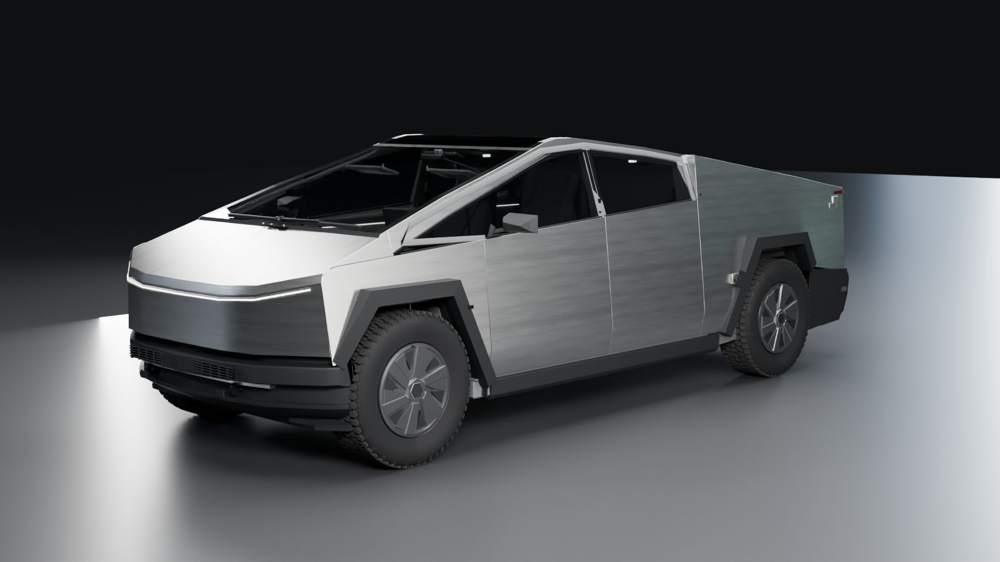

| | |
|---|---|
| 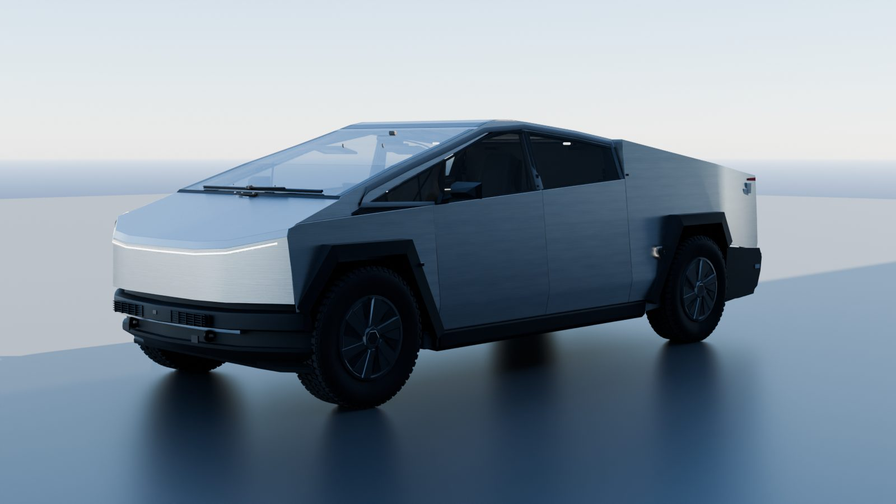 | 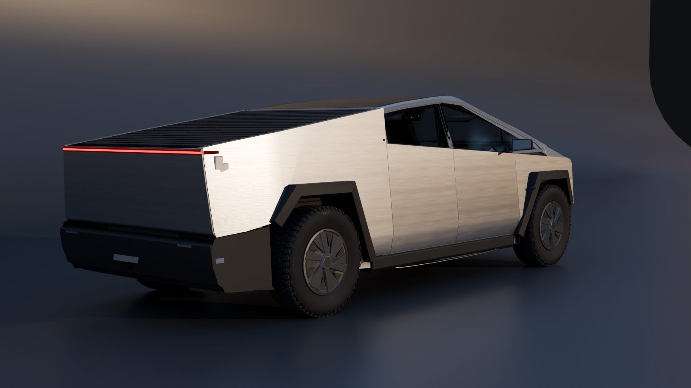 |
| 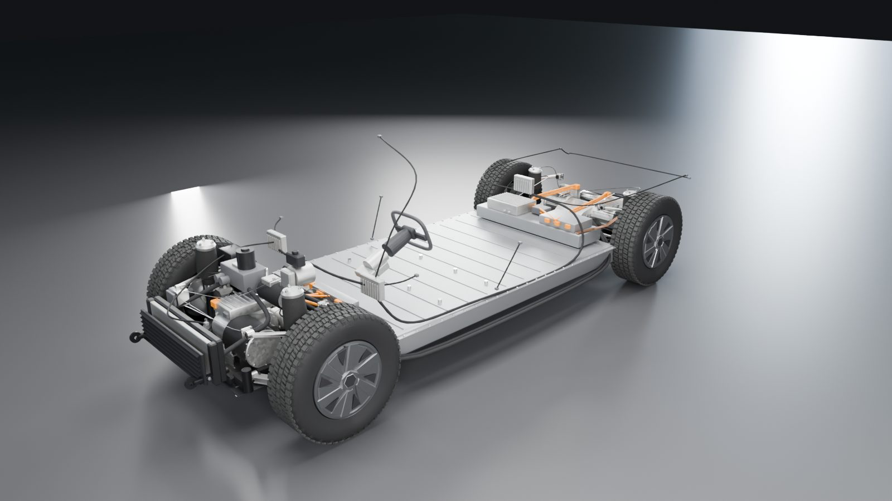 | 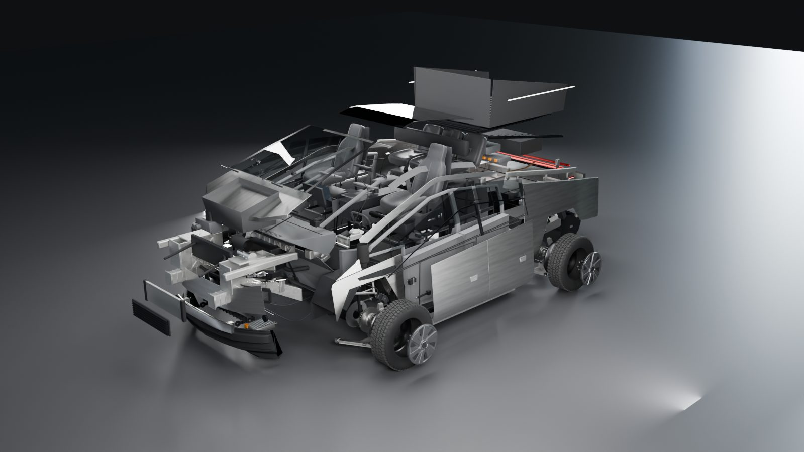 |
| 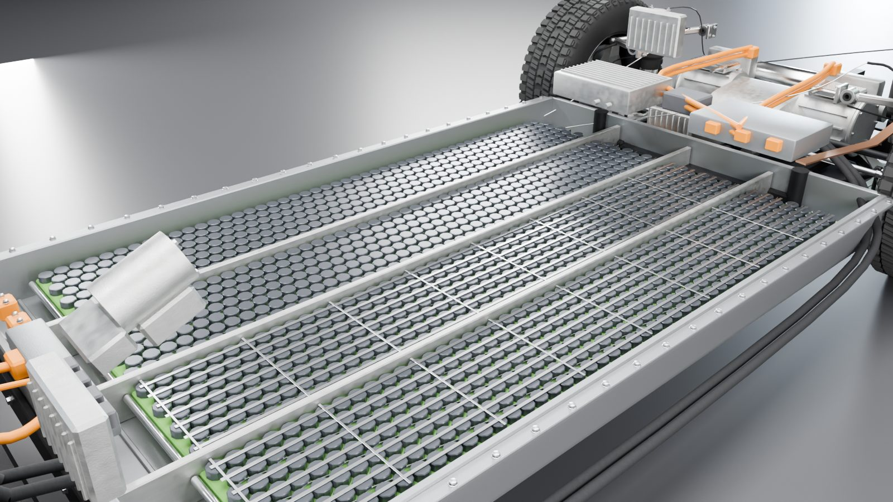 | 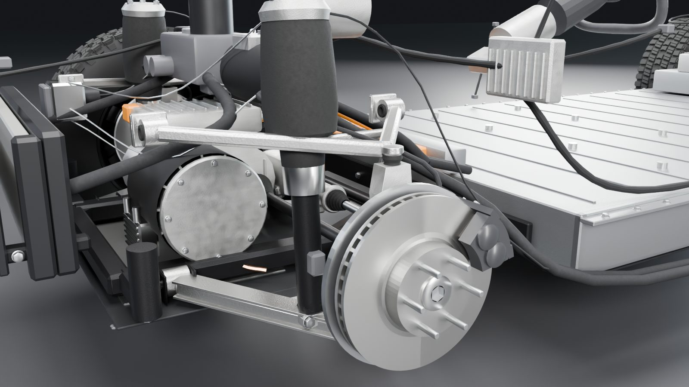 |
| 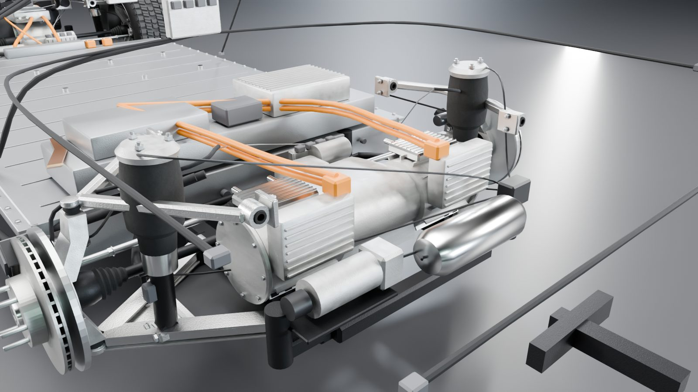 | 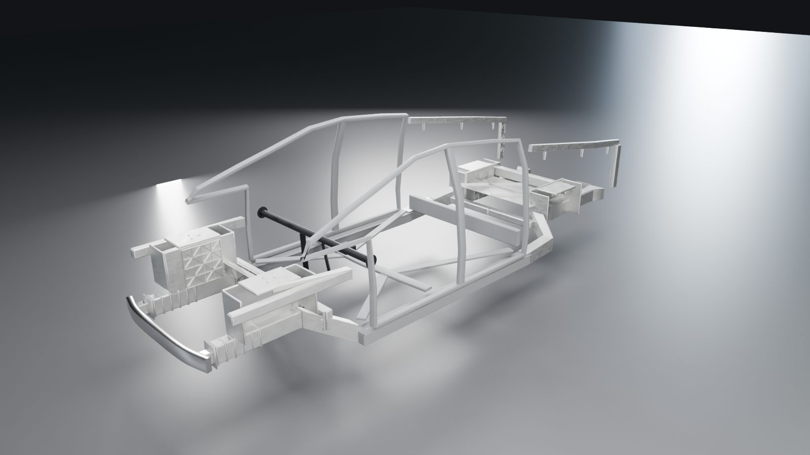 |
| 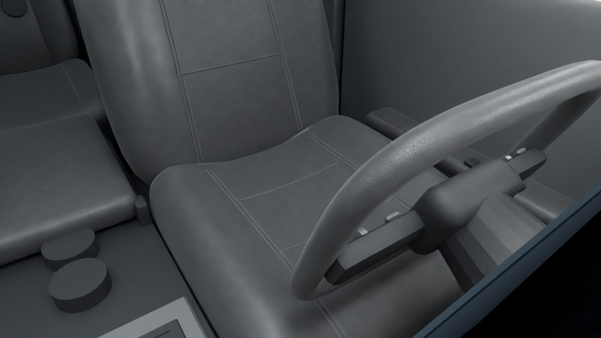 | 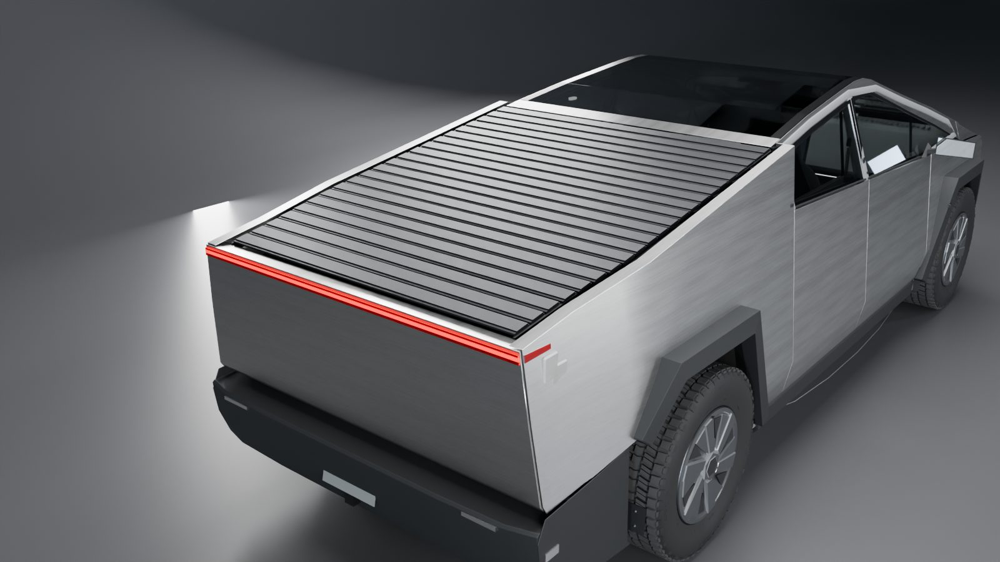 |
| 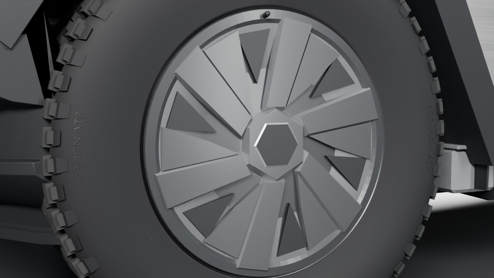 | 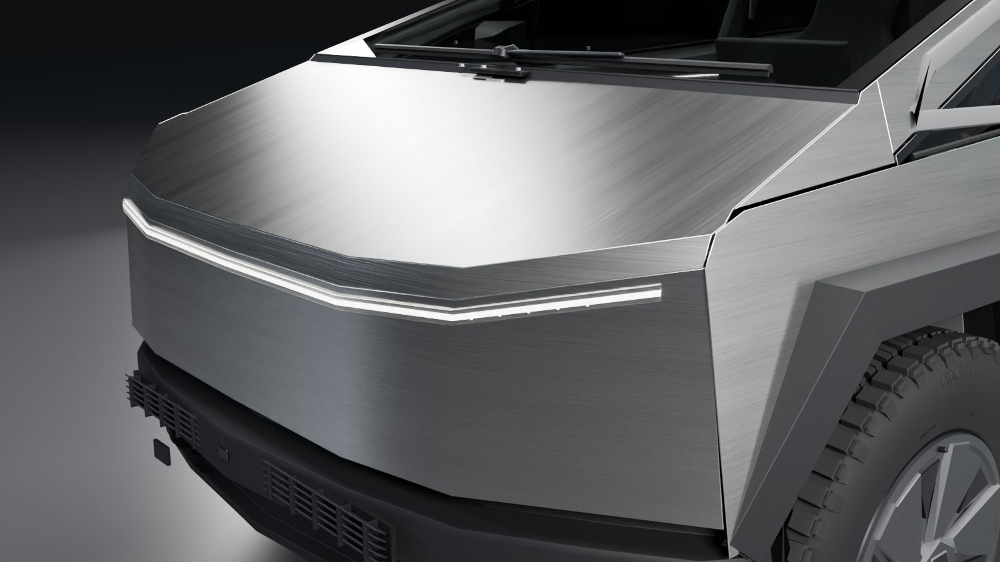 |

Los 21 planos de `docs/renders/` se renderizan con Cycles bajo cuatro iluminaciones (estudio, cielo físico de
día, atardecer y cielo cubierto).

## Qué contiene (versión 2)

- **561 objetos** (522 mallas y 38 conjuntos) en 20 colecciones de sistema, frente a 309 en la versión 1. Muchas
  mallas agrupan piezas repetidas (1.344 celdas, tornillería, grapas, remaches), por lo que el número de piezas
  físicas representadas es muy superior.
- **Estructura de carrocería** con las cotas de control del manual de reparación: piezas fundidas delantera y
  trasera (esta por mitades), umbrales de acero UHSS con inserto extruido, refuerzos del suelo, anillos de
  puertas, «mast» y torres del portón fundidos, vigas de impacto, Megabeam, viga del salpicadero y remaches
  flow-form.
- **Mecánica**: suspensión de doble horquilla con portamanguetas, brazos con casquillos y rótulas, módulos de
  muelle neumático desglosados (amortiguador, vástago, fuelle, pistón, copela), estabilizadoras, actuadores de
  dirección por cable con dos motores, unidades motrices con carcasas aleteadas, inversores, intercambiadores,
  bombas de aceite y soportes, semiejes con juntas y fuelles, subchasis, Supermanifold/Octovalve, compresor de
  A/C, módulo de ventiladores, persianas activas, servofreno electromecánico, HCU, tubos de freno, compresor,
  depósito y bloque de válvulas de la suspensión, batería de 48 V, controladores zonales, mazos de cables y
  deflectores inferiores.
- **Batería** de 4 bloques de 7 × 48 celdas 4680 con espuma estructural, refrigeradores en serpentín, mica,
  colectores, pirofusibles, respiradero térmico y bahía auxiliar (ACJB, PCS, clúster de dispositivos).
- **Exterior**: faros con proyectores y disipadores, fila de 64 LED en la barra de luz, retrovisores facetados con
  cristal electrocrómico, limpiaparabrisas completo con motor y lavaparabrisas, bisagras, cierres, presentadores,
  elevalunas, controladores y burletes de las puertas, herrajes del frunk y del portón, cubierta con raíles,
  motores, casete y lamas extruidas, toma NACS con contactos, faldillas, difusor y soporte frontal.
- **Ruedas**: neumático con dibujo «all-terrain» de 5 hileras, tacos de flanco e inscripciones en relieve,
  tapacubos Core facetado, válvula con TPMS, buje con espárragos, pinzas detalladas y pastillas.
- **Interior**: volante con botonera y rodillos, actuador de realimentación, consola esculpida con cargadores
  inalámbricos y USB-C, guantera, desempañado, guarnecidos de pilares con altavoces, paneles de puerta completos con
  luz ambiental, asientos con guías, mandos y costuras proyectadas, cinturones con enrolladores y hebillas,
  climatización, ordenador, airbags y alfombrillas.
- **Materiales con texturas físicas** generadas (acero satinado anisótropo, caucho, granulado, piel, tejido,
  moqueta, fundición) que viajan al GLB (WebP + KHR_texture_transform), por lo que el visor web muestra el
  mismo aspecto que Blender.
- **Cotas oficiales intactas**: longitud +2,0 mm, batalla y vía exactas, altura libre −0,4 mm, altura +2,9 mm,
  anchura con espejos exacta (0,0 mm). Detalles en [`docs/research-and-fidelity.md`](docs/research-and-fidelity.md).
- **Metadatos y vista explosionada** en 6 etapas para cada pieza; desviación 0 tras ciclos repetidos en Blender
  y en el navegador.

## Estructura del repositorio

```
CLAUDE.md                       Normas permanentes del proyecto (idioma español, convenciones)
blender/Cybertruck.blend        Escena maestra de Blender (no se elimina nunca)
blender/scripts/                Scripts de construcción, validación y exportación (Python/bpy)
blender/reference_data/         Perfiles medidos sobre la vista oficial (datos derivados)
blender/textures/               Texturas físicas generadas por script (WebP)
web/                            Visor web estático (GitHub Pages)
web/models/                     cybertruck.glb (Draco) y manifiesto de componentes
docs/                           Investigación, especificación, inventario, validación y renders
tools/                          Servidor estático local y generador del inventario
.github/workflows/pages.yml     Despliegue automático del visor
```

## Abrir la escena de Blender

1. Abrir `blender/Cybertruck.blend` con Blender 5.2 o posterior.
2. La colección **CYBERTRUCK** contiene el vehículo; **STUDIO**, el estudio, las luces y las 10 cámaras de
   inspección (`CAM_3Q_Front`, `CAM_Side_Profile`, `CAM_Interior`, `CAM_Underbody`, `CAM_Exploded`, …).
3. **Vista explosionada:** seleccionar `CYBERTRUCK_ROOT` y modificar su propiedad personalizada `explode`
   (Propiedades del objeto → Propiedades personalizadas) entre 0 y 1. Los controladores usan expresiones simples,
   por lo que funcionan sin habilitar la ejecución automática de scripts.

### Regenerar el modelo desde los scripts

En la consola de Python de Blender:

```python
import sys; sys.path.insert(0, r"<ruta-del-repo>/blender/scripts")
import build_all
build_all.run(parts=("body", "wheels", "lights", "details", "interior", "chassis", "explode", "scene"))
import validate; print(validate.run())            # cotas y siluetas
import export_web
export_web.export(r"<ruta-del-repo>/web/models/cybertruck.glb",
                  r"<ruta-del-repo>/web/models/cybertruck-manifest.json")
```

`build_all.run` solo elimina y regenera la colección CYBERTRUCK; el resto de la escena se conserva.

## Visor web

No requiere compilación: es HTML + módulos ES con Three.js 0.170 cargado desde jsDelivr.

```bash
node tools/serve.mjs web 8080
```

Abrir `http://localhost:8080/`. Funciones:

- Rotación, zoom y desplazamiento con ratón o gestos táctiles; cámaras predefinidas y botón «Restablecer vista».
- **Barra «Vista explosionada» 0–100 %**, control de amplitud, animación automática y botón «Ensamblar».
- Pulsar sobre una etapa la excluye o incluye de la explosión (exploración selectiva).
- Clic en una pieza: resaltado y ficha con sistema, conjunto, etapa y nivel de fidelidad; acciones **Aislar**,
  **Ocultar** y **Encuadrar**.
- Panel de sistemas (mostrar/ocultar por sistema) y árbol de componentes con búsqueda y ocultación individual.

Tras modificar el modelo en Blender, regenerar el inventario con `node tools/gen_inventory.mjs`.

## Despliegue

El flujo `.github/workflows/pages.yml` publica la carpeta `web/` en GitHub Pages en cada *push* a `main` que
modifique el visor (también se puede lanzar manualmente). Requiere que Pages esté configurado con
«Source: GitHub Actions» en los ajustes del repositorio.

## Documentación

- [Investigación y registro de fidelidad](docs/research-and-fidelity.md) — fuentes, método de medición,
  ficha técnica, categorías V/R/A por conjunto, discrepancias y resultados de validación.
- [Especificación del modelo](docs/model-specification.md) — coordenadas, jerarquía, metadatos, sistema de
  explosión, materiales y canal de producción.
- [Inventario de componentes](docs/component-inventory.md) — generado a partir de los objetos reales.
- [Resultados de validación](docs/validation-results.json).

## Limitaciones principales

- La carrocería exterior está reconstruida con gran precisión dimensional, pero la sección transversal depende de
  dos inclinaciones deducidas (6° y 19°) que no se han podido medir en una vista frontal a escala.
- Mecánica, batería, piezas fundidas e interior respetan la denominación, las fijaciones y las cotas de control
  de los manuales, pero sus formas son reconstrucciones (no hay planos CAD públicos).
- El dibujo del neumático sigue la arquitectura de un «all-terrain» de 5 hileras, no el molde exacto del Scorpion
  ATR; las inscripciones usan una tipografía genérica.
- La anchura «sin espejos» oficial (2.031,6 mm) no es compatible con la anchura de los neumáticos; el modelo
  sigue la planta oficial, con aletas a ±1,04 m (2.081,7 mm).
- Las texturas son sintéticas (no escaneadas); el GLB pesa 5,3 MB y se carga de una vez.

## Créditos y derechos

Proyecto de reconstrucción independiente, sin afiliación con Tesla, Inc. «Tesla», «Cybertruck» y «Cyberbeast» son
marcas de Tesla, Inc. No se incluyen fotografías ni imágenes de terceros: solo datos de medición derivados.
