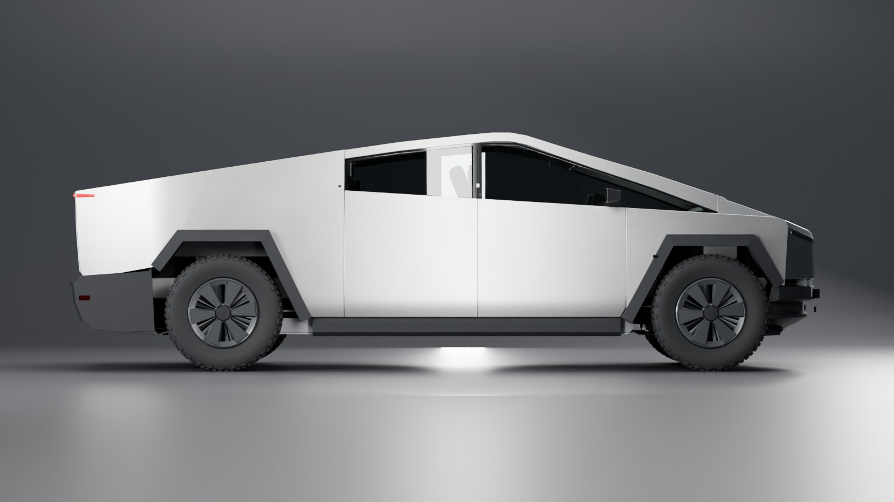
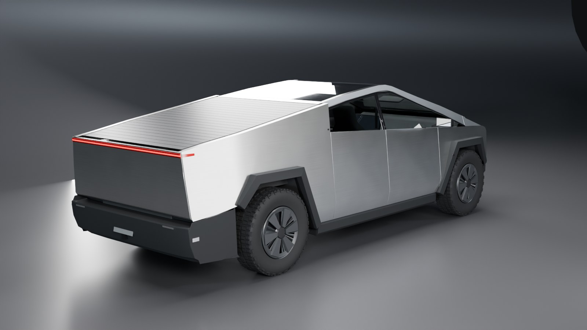
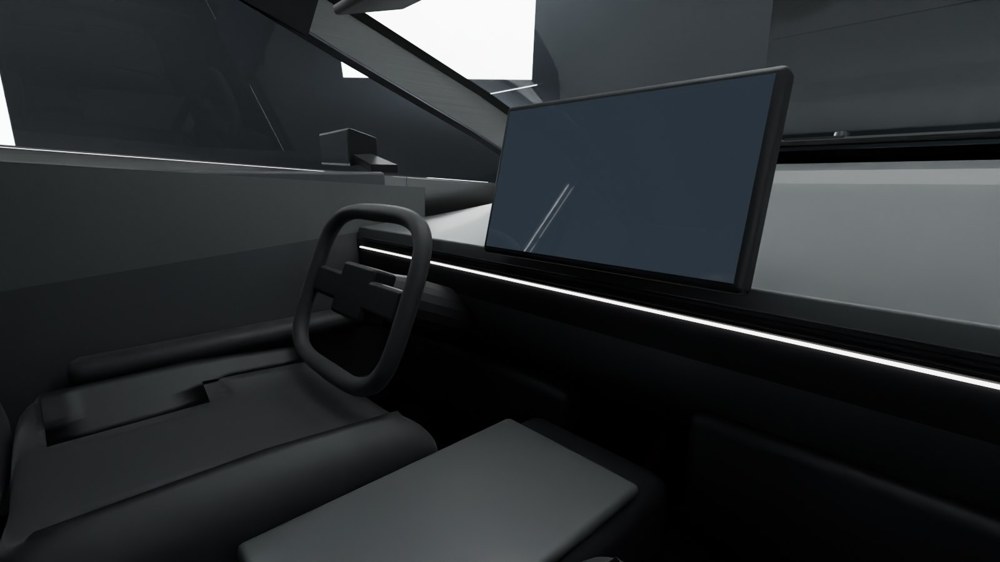
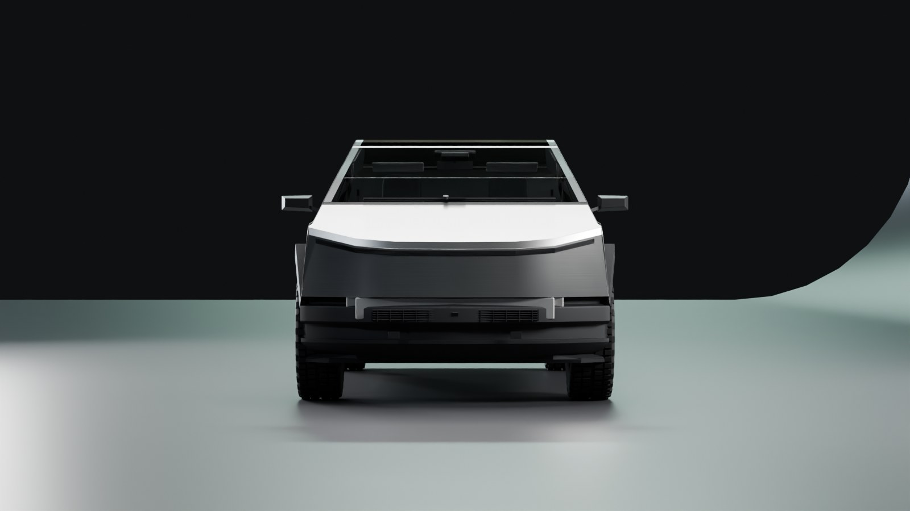

# Cybertruck — reconstrucción 3D documentada

Reconstrucción 3D a escala 1:1 del **Tesla Cybertruck Cyberbeast** (gama comercial vigente en EE. UU.),
construida en **Blender 5.2** a partir de la documentación oficial de Tesla y de mediciones sobre sus vistas
ortográficas, con **vista explosionada reversible** y un **visor web interactivo** en Three.js.

**Visor en línea:** https://alvarodesigns34.github.io/cybertruck/


| | |
|---|---|
|  |  |
|  |  |
|  |  |

## Qué contiene

- **309 objetos organizados** en 20 colecciones de sistema: paneles exteriores, puertas y portones, cristales,
  iluminación, ruedas y frenos, suspensión de doble horquilla con muelle neumático, dirección por cable
  delantera y trasera, batería con 1.344 celdas 4680, unidad motriz delantera y unidad trasera con dos motores,
  bajos y subchasis, caja de carga con tonneau de 22 lamas, y habitáculo completo de cinco plazas con pantallas
  de 18,5" y 9,4".
- **Cotas oficiales respetadas** (validadas sobre la geometría final): longitud +2,0 mm, batalla y vía exactas,
  altura libre −0,4 mm, altura total +2,9 mm. Perfil superior con error medio de 2,9 mm frente a la vista oficial.
  Detalles en [`docs/research-and-fidelity.md`](docs/research-and-fidelity.md).
- **Cada componente lleva metadatos** (sistema, descripción, nivel de fidelidad *Verificado / Reconstruido /
  Aproximado*, dirección y etapa de explosión).
- **Vista explosionada en 6 etapas lógicas**, implementada con controladores en Blender y reproducida en el visor:
  el ensamblado se recupera exactamente (desviación 0 verificada tras ciclos repetidos).

## Estructura del repositorio

```
CLAUDE.md                       Normas permanentes del proyecto (idioma español, convenciones)
blender/Cybertruck.blend        Escena maestra de Blender (no se elimina nunca)
blender/scripts/                Scripts de construcción, validación y exportación (Python/bpy)
blender/reference_data/         Perfiles medidos sobre la vista oficial (datos derivados)
web/                            Visor web estático (GitHub Pages)
web/models/                     cybertruck.glb (Draco) y manifiesto de componentes
docs/                           Investigación, especificación, inventario, validación y renders
tools/                          Servidor estático local y generador del inventario
.github/workflows/pages.yml     Despliegue automático del visor
```

## Abrir la escena de Blender

1. Abrir `blender/Cybertruck.blend` con Blender 5.2 o posterior.
2. La colección **CYBERTRUCK** contiene el vehículo; **STUDIO**, el estudio, las luces y las 10 cámaras de
   inspección (`CAM_3Q_Front`, `CAM_Side_Profile`, `CAM_Interior`, `CAM_Underbody`, `CAM_Exploded`, …).
3. **Vista explosionada:** seleccionar `CYBERTRUCK_ROOT` y modificar su propiedad personalizada `explode`
   (Propiedades del objeto → Propiedades personalizadas) entre 0 y 1. Los controladores usan expresiones simples,
   por lo que funcionan sin habilitar la ejecución automática de scripts.

### Regenerar el modelo desde los scripts

En la consola de Python de Blender:

```python
import sys; sys.path.insert(0, r"<ruta-del-repo>/blender/scripts")
import build_all
build_all.run(parts=("body", "wheels", "lights", "details", "interior", "chassis", "explode", "scene"))
import validate; print(validate.run())            # cotas y siluetas
import export_web
export_web.export(r"<ruta-del-repo>/web/models/cybertruck.glb",
                  r"<ruta-del-repo>/web/models/cybertruck-manifest.json")
```

`build_all.run` solo elimina y regenera la colección CYBERTRUCK; el resto de la escena se conserva.

## Visor web

No requiere compilación: es HTML + módulos ES con Three.js 0.170 cargado desde jsDelivr.

```bash
node tools/serve.mjs web 8080
```

Abrir `http://localhost:8080/`. Funciones:

- Rotación, zoom y desplazamiento con ratón o gestos táctiles; cámaras predefinidas y botón «Restablecer vista».
- **Barra «Vista explosionada» 0–100 %**, control de amplitud, animación automática y botón «Ensamblar».
- Pulsar sobre una etapa la excluye o incluye de la explosión (exploración selectiva).
- Clic en una pieza: resaltado y ficha con sistema, conjunto, etapa y nivel de fidelidad; acciones **Aislar**,
  **Ocultar** y **Encuadrar**.
- Panel de sistemas (mostrar/ocultar por sistema) y árbol de componentes con búsqueda y ocultación individual.

Tras modificar el modelo en Blender, regenerar el inventario con `node tools/gen_inventory.mjs`.

## Despliegue

El flujo `.github/workflows/pages.yml` publica la carpeta `web/` en GitHub Pages en cada *push* a `main` que
modifique el visor (también se puede lanzar manualmente). Requiere que Pages esté configurado con
«Source: GitHub Actions» en los ajustes del repositorio.

## Documentación

- [Investigación y registro de fidelidad](docs/research-and-fidelity.md) — fuentes, método de medición,
  ficha técnica, categorías V/R/A por conjunto, discrepancias y resultados de validación.
- [Especificación del modelo](docs/model-specification.md) — coordenadas, jerarquía, metadatos, sistema de
  explosión, materiales y canal de producción.
- [Inventario de componentes](docs/component-inventory.md) — generado a partir de los objetos reales.
- [Resultados de validación](docs/validation-results.json).

## Limitaciones principales

- La carrocería exterior está reconstruida con gran precisión dimensional, pero la sección transversal depende de
  dos inclinaciones deducidas (6° y 19°) que no se han podido medir en una vista frontal a escala.
- Interior, mecánica, batería y piezas fundidas son reconstrucciones plausibles a escala, no geometría OEM.
- El dibujo de la banda de rodadura es genérico y no hay inscripciones en los flancos.
- La anchura «sin espejos» oficial (2.031,6 mm) no es compatible con la anchura de los neumáticos; el modelo
  sigue la planta oficial, con aletas a ±1,04 m (2.081,7 mm).
- Los materiales procedurales de Blender se aproximan en el navegador con `MeshPhysicalMaterial`.

## Créditos y derechos

Proyecto de reconstrucción independiente, sin afiliación con Tesla, Inc. «Tesla», «Cybertruck» y «Cyberbeast» son
marcas de Tesla, Inc. No se incluyen fotografías ni imágenes de terceros: solo datos de medición derivados.
